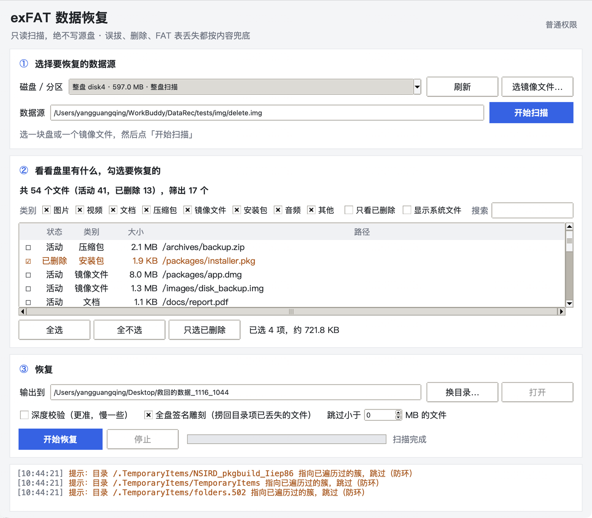

# DataRec — exFAT 数据恢复工具（macOS / Windows / 只读）

误拔移动硬盘之后，exFAT 最常见的坏法是：**目录项还在，但 FAT 链和分配位图没来得及刷盘**。
于是系统挂载后表现为"文件在、大小是 0 / 点进去是空的 / 拷贝报错"，而磁盘工具扫描又一切正常。

这个工具绕开系统挂载，直接解析卷上的原始结构：

1. **按目录项恢复** —— 从 exFAT 目录项里取 `FirstCluster` / `DataLength` / `NoFatChain` 标志，
   不信任 FAT 链。macOS 写 exFAT 时几乎总是连续分配（目录项里 `flags=3`），
   所以哪怕 FAT 全空，文件也能整段原样读出来。
2. **断链兜底** —— 链断了就从 `FirstCluster` 开始按内容结构重新判定长度（JPEG 走 marker、
   MP4 走 box 树、ZIP 用 EOCD 反推起点……）。
3. **全盘签名雕刻** —— 目录项彻底没了，就按魔数把文件从数据区里"凿"出来。

全程 **只读**：源数据以只读方式打开（Windows 上从 API 层面只申请 `GENERIC_READ`），
并且写盘前会拦"输出目录就在待恢复卷上"这种自杀操作。



---

## 一、先读这一段（安全铁律）

> 恢复失败的绝大多数原因不是工具不行，而是**在出事的盘上又写了东西**。

1. **别往出事的那块盘里写任何文件**（包括本程序的输出目录）。
2. **先卸载卷**，最好先做一份整盘镜像，对着镜像恢复：

```bash
diskutil list                       # 找到你的移动硬盘，比如 /dev/disk4s1
diskutil unmountDisk /dev/disk4     # 卸载（不要用 eject，eject 会重新挂载）
sudo dd if=/dev/rdisk4 of=~/Desktop/exfat.img bs=4m    # 整盘克隆，几 GB 也就几分钟
```

3. 恢复结果一律输出到**内置硬盘**（`~/Desktop/…`）。

对镜像文件操作不需要 `sudo`，也完全不怕误写，是最稳的用法。

Windows 用户把 `diskutil` 那两步换成：在「磁盘管理」里对目标卷右键「脱机」，
或直接安全弹出后用另一台电脑做镜像。数据源路径写 `\\.\PhysicalDrive1`（整盘）或 `\\.\F:`（分区）。

---

## 二、图形界面（推荐先用这个）

不用记任何命令。双击运行：

```bash
python3 datarec_gui.py          # macOS / Windows 都一样
python3 datarec.py gui          # 等价写法
```

界面分四步，从上往下做就行：

1. **选择数据源** —— 下拉框里是本机外接磁盘和分区（内置系统盘默认不列出来，
   点「显示内置磁盘」才会出现）；也可以选一个镜像文件。
2. **开始扫描** —— 列出活动文件和已删除文件，橙色行是已删除的。
   可以按类别筛、按名字搜、勾选只恢复其中几个（不勾就恢复筛出的全部）。
3. **恢复** —— 选好输出目录（必须是本机硬盘），点「开始恢复」。
   进度条实时走，随时可以「停止」，已恢复的部分和报告都会保留。
4. **看报告** —— 完成后可一键打开输出目录，`report.md` / `report.csv` 照常生成。

权限说明：读物理磁盘需要管理员。Windows 上点右上角「以管理员身份重启」弹 UAC 即可；
macOS 上用 `sudo python3 datarec_gui.py` 启动，或先 `dd` 成镜像再对镜像操作（不需要 root）。

### 打包成可双击的程序

**先说个坑：PyInstaller 不能跨平台编译。** 在 Mac 上打不出 Windows 的 exe，
因为打包的本质是把「当前平台的 Python 解释器 + 依赖」塞进可执行文件外壳，
macOS 上手里只有 macOS 的解释器。所以 `exe` 必须由 Windows 来打。

三条路，按省事程度排：

| 做法 | 需要 | 说明 |
| --- | --- | --- |
| 拷到 Windows 上跑 `build_windows.bat` | 一台 Windows | 双击脚本等两分钟，产物 `dist\DataRec.exe` |
| 用 GitHub Actions 的云端 Windows | 一个 GitHub 仓库（免费） | 把项目推上去 → Actions 页 → build-windows → Run workflow，跑完下载 `DataRec.exe`。不用自己装 Windows |
| Windows 虚拟机 | Parallels / UTM + Windows | 能用，但为一个 exe 装整套系统不划算 |

macOS 本机打包（产出 `.app`，不是 exe）：

```bash
bash build_mac.sh          # 产出 dist/DataRec.app，可双击
bash build_mac.sh --dmg    # 顺便做个分发包 dist/DataRec.dmg
```

未签名的 .app 首次打开若被 Gatekeeper 拦，右键 →「打开」，或
`xattr -dr com.apple.quarantine dist/DataRec.app`。读物理磁盘需要在终端里
`sudo dist/DataRec.app/Contents/MacOS/DataRec`（对镜像文件不需要）。

---

## 四、命令行快速上手

只需要 Python 3.10+，**没有任何第三方依赖**。

```bash
# 1) 先体检：看清卷结构、有多少已删除文件、FAT 链坏没坏
python3 datarec.py info -s /dev/rdisk4s1

# 2) 恢复（输出到桌面，保留原目录结构与文件名）
python3 datarec.py recover -s /dev/rdisk4s1 -o ~/Desktop/救回的数据

# 3) 打开报告
open ~/Desktop/救回的数据/report.md
```

读原始设备需要管理员权限：命令前加 `sudo` 即可。
对镜像文件（`exfat.img`）不需要 `sudo`。

如果只关心某几类文件，加 `--types` 能显著省时间：

```bash
python3 datarec.py recover -s exfat.img -o ~/Desktop/out --types images,videos
```

---

## 四、命令

| 命令 | 作用 |
| --- | --- |
| `gui` | 打开图形界面 |
| `disks` | 列出磁盘与分区（含容量/挂载状态），不用自己去翻设备名 |
| `info` | 卷信息 + 可恢复性体检（活动/已删除文件数、FAT 链健康度、脏标志） |
| `list` | 列出文件条目，含已删除项（`--deleted` 只看删除的） |
| `recover` | 执行恢复：目录项 → 断链兜底 → 全盘雕刻 |
| `carve` | 跳过文件系统，纯按内容雕刻 |

### recover 常用参数

| 参数 | 说明 |
| --- | --- |
| `-s, --source` | 数据源：`/dev/rdisk4s1`、`/dev/rdisk4`（整盘，自动找分区）、Windows 的 `\\.\PhysicalDrive1` 或 `\\.\F:`，或镜像文件 |
| `-o, --out` | 输出目录，默认 `./recovered_<时间戳>` |
| `--types` | 只要这些类别：`images,videos,audio,documents,archives,diskimages,packages` |
| `--no-carve` | 只按目录项恢复，不扫全盘（快很多） |
| `--carve-all` | 雕刻时不跳过已恢复文件占用的区域（更慢，能发现藏在里面的文件） |
| `--deep-verify` | 对每个文件做完整结构复算（更准、更慢） |
| `--min-size` | 小于该字节数跳过 |
| `--start/--end` | 只扫某个区间（大容量盘分段扫很有用） |
| `--dry-run` | 只演练不落盘，先看能救出什么 |
| `--keep-appledouble` | 保留 macOS 的 `._` 资源叉文件（默认跳过） |
| `--offset` | 手动指定引导扇区偏移（默认自动探测 MBR/GPT） |

---

## 五、输出结构

```
救回的数据/
├── files/            # 活动文件，保留原始目录结构和文件名
├── deleted/          # 已删除文件，名字来自删除前的目录项
├── carved/           # 目录项已丢失，纯按内容雕刻出来的
│   ├── images/  videos/  documents/  archives/  diskimages/  packages/
├── report.md         # 给人看的报告（卷信息、统计、可疑清单、下一步建议）
└── report.csv        # 给 Excel 的明细（UTF-8 BOM，中文不乱码）
```

文件名冲突会自动加 `_1`；内容完全相同的文件只留一份，其余在报告里记为"重复"。
判定为可疑的文件会在文件名后加 `__可疑`。

## 六、报告里的状态怎么读

| 状态 | 含义 | 建议 |
| --- | --- | --- |
| **完整** | 文件头魔数 + 尾部结束标记都闭合（JPEG 有 `FFD9`、ZIP 的 EOCD 正好贴着文件尾……） | 直接打开用 |
| **可用（可能不完整）** | 类型对，但缺尾部标记，或内容本身没有魔数（如 `.img`） | 逐个打开确认 |
| **可疑** | 认不出内容 / 结构不成立 / 内容和扩展名对不上 | 大概率是簇已被覆盖，救回来的是别的数据 |
| **重复** | 与已恢复的某个文件逐字节相同 | 忽略 |

几个常见备注的含义：

- `FAT 链不完整（簇 X 的表项是 0），按连续簇读取` —— 这就是误拔留下的痕迹，属于正常工作路径。
- `位图显示数据区 100% 的簇已被占用` —— 删除后簇又被别的文件占了，数据可能已被覆盖。
- `内容像是 gzip，与扩展名 .png 不符` —— 这个簇已经是别人的数据了。

---

## 七、实测数据

测试环境用 `newfs_exfat` 造了 96 MB 的 exFAT 卷，写入 17 个真实结构的样本
（JPEG/PNG/TIFF/HEIC、MP4/MOV/MKV、PDF/DOCX/XLSX/PPTX/TXT、ZIP、8 MB 的 GPT 磁盘镜像、真 `.pkg` 和真 `.dmg`），
然后人为制造三种事故现场：

| 场景 | 怎么造的 | 字节级召回 |
| --- | --- | --- |
| `base` | 正常卷（对照组） | **17/17（100%）** |
| `delete` | `rm` 掉 5 个文件 | **16/17（94%）** —— 缺失的那个 PNG，簇已被 fsevents 数据覆盖 |
| `crash_fat` | FAT 表和分配位图全部清零（模拟没弹盘就拔） | **17/17（100%）** |
| `crash_meta` | 上述基础上再抹掉两个目录项/目录簇 | **16/17（94%）** —— 缺的是纯文本（无魔数，名字也丢了） |

判定标准是 SHA-256 与原文件逐字节一致，不是"能打开"。

复现：

```bash
bash tests/build_env.sh          # 造卷 + 写样本 + 生成三类事故镜像（约 1 分钟）
python3 tests/evaluate.py        # 跑恢复并与原始哈希比对，打印召回率
```

扫描速度约 **40 MB/s**（95 MB 卷约 3 秒，含目录解析与雕刻）。1 TB 盘全盘雕刻约 7 小时，
所以先用 `--types` 或 `--start/--end` 缩小范围。

---

## 八、实现要点

想改代码的话，这几个坑值得知道：

- **删除只清 in-use 位**：`0x85→0x05`、`0xC0→0x40`、`0xC1→0x41`，目录项自带的设校验和**不会重算**。
  所以校验已删除条目时必须先把这些位还原再算，否则全部判为"损坏"。
- **卷标项的偏移 1 是字符数，不是从属项数**。按从属项跳过会把紧跟其后的真实目录项整段吞掉。
- **目录遍历要知道什么时候停**：每读下一个簇先判断它"像不像目录簇"（存在校验和能对上的目录项集合），
  不像就停。否则会把相邻文件的数据当目录项，凭空造出一堆幽灵文件。
- **`NoFatChain`（`GeneralSecondaryFlags` 的 bit1）** 表示连续分配，直接按簇号顺序读即可。
  macOS 写 exFAT 时几乎总是置这个位——这正是"FAT 丢了也能全救回来"的原因。
- **长度推断必须真解析结构**：ZIP 用 EOCD 里的中央目录偏移反推起点（`eocd - cd_size - cd_off == 0` 才算准），
  MP4 走 box 树，DMG 从尾部 `koly` 反推，GPT 镜像用备份头所在的 LBA 算总长。
  只"往后找下一个魔数"的写法在容器的尾巴上会错得离谱。
- **性能**：不要用"几十个魔数拼成一条正则"。Python `re` 在二进制数据上会退化成逐位置尝试，
  实测只有 1.5 MB/s；改成每个魔数各做一次 `bytes.find`（C 层 memchr）再合并命中位置，
  能到 40 MB/s 以上。
- **雕刻时一定要跳过整个已命中的文件**，否则 `mdat` 里嵌的 `ftyp` 会被当成新文件。

---

## 九、已知限制

- **只支持 exFAT**。HFS+/APFS/NTFS/ext4 需要别的工具。
- **纯文本、无固定魔数的文件**（`.txt`/`.md`/`无扩展名`）：只要目录项没了就救不回来，
  因为没法从内容判断边界。目录项还在的话照常恢复。
- **被覆盖的数据救不回来**。工具会尽可能把它标成"可疑"而不是假装成功。
- **`.pkg`（xar）的长度** 只能确认到头部+TOC，剩余堆区靠边界裁剪；
  目录项完好时长度是准的（用目录项声明的长度）。
- 加密归档、分卷压缩包、Time Machine 备份需要各自的原生工具。
- 单个 ZIP 的搜索窗口上限 4 GB、PDF 为 2 GB（超过部分可能截断）。
- 机械盘有坏道时，`--deep-verify` 可能反复报 I/O 错误；先做镜像再用 `ddrescue` 更专业。

---

## 十、常见问题

**`打不开 /dev/disk4s1：Resource busy`**
卷还挂着。`diskutil unmountDisk /dev/disk4` 之后再来。

**Windows 下提示拒绝访问 / 打不开物理磁盘**
读物理磁盘必须管理员：右键 → 以管理员身份运行（或用界面右上角的「以管理员身份重启」）。
另外正在被杀毒软件或资源管理器占用的盘可能打不开，先关掉占用程序。
macOS 对应的报错是 `Operation not permitted`，用 `sudo` 或先做镜像。

**`需要管理员权限`**
`sudo python3 datarec.py ...`。或者干脆先 `dd` 成镜像，对镜像恢复就不需要 root。

**卷已经卸载了，`diskutil list` 里却看不到**
确认拔插的是哪块盘；外接盘建议用 `/dev/rdisk*`（无缓冲，快很多）。

**扫描很慢**
加 `--types images,videos`；或者 `--start/--end` 分段扫；机械盘 USB 2.0 接口本身就是瓶颈。

**恢复出来的文件打不开**
看 `report.csv` 里该文件的状态和备注。判"可疑"的通常是簇已被覆盖，
可以再试 `--deep-verify --carve-all` 交叉验证一遍。

---

## 十一、目录

```
datarec.py              命令行入口
datarec_gui.py          图形界面入口（打包 exe 也用它）
datarec/
├── oslayer.py          跨平台设备访问层（枚举磁盘、只读打开、Windows DeviceIoControl）
├── device.py           只读数据源（设备/镜像），pread 封装
├── exfat.py            引导扇区、FAT、位图、目录项解析与遍历
├── formats.py          扩展名 ↔ 类别 ↔ 魔数格式映射
├── signatures.py       魔数识别、长度推断（JPEG/PNG/MP4/ZIP/PDF/DMG/GPT…）
├── carve.py            流式签名扫描
├── verify.py           落盘后的可信度校验
├── recover.py          恢复主流程：目录项 → 断链兜底 → 雕刻
├── report.py           CSV / Markdown 报告
├── gui.py              tkinter 图形界面
└── cli.py              子命令与参数
tests/
├── build_env.sh        重建测试卷与三类事故镜像
├── make_samples.py     生成结构真实的样本文件
├── make_scenarios.py   制造"删除 / 误拔 / 目录项丢失"
└── evaluate.py         跑恢复并按 SHA-256 算召回率
build_windows.bat       Windows 一键打包成单文件 exe
build_mac.sh            macOS 一键打包成 .app（可选 --dmg）
.github/workflows/      云端 Windows 构建，Mac 上也能拿到 exe
```
